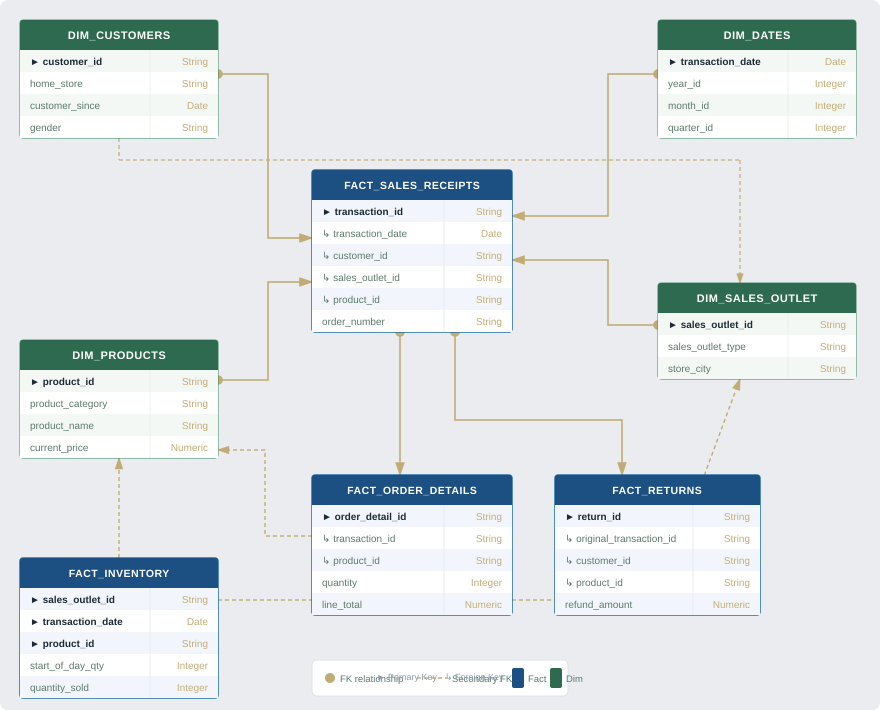
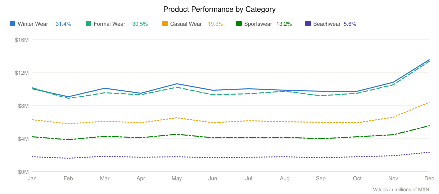
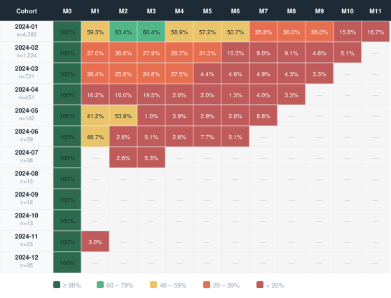

  

# Ecommerce Performance Report 
<table align="center">
    <tr>
      <td width="1470">
        <h2 align="center">Client Background</h2>
        <body>
          <strong>VISTARA</strong> is a Mexican premium fashion e-commerce brand specializing in curated apparel and accessories for the contemporary Latin American consumer.
            Founded with a focus on quality craftsmanship and digital-first retail, VISTARA has grown its online presence across Mexico by combining editorial aesthetics with data-driven customer experiences.  
              
            With a registered customer base of over 10,000 buyers and more than 219,000 transactions processed throughout 2024, the brand operates at a scale where customer behavior patterns become both measurable and 
            strategically actionable.  
             
            This report covers the full 2024 fiscal year (January – December), with January 1, 2025 set as the RFM reference anchor. The analysis was commissioned to support VISTARA's growth strategy heading into 2025 —
            identifying where revenue is being generated, which customers are at risk of churning, and where the highest-value acquisition cohorts are coming from.  
             
        <body>
        <h3>Northstar metrics for this analysis:</h3>
        <h4>
            <ul><li>📈 Monthly net revenue trend and MoM growth</li>
                <li>🎯 RFM customer segmentation (Recency · Frequency · Monetary)</li>
                <li>🔄 Churn risk classification and retention rate</li>
                <li>👥 Cohort retention — tracking customer lifetime month by month </li>
            <ul>
        </h4>
        </td>
  </tr>
</table>
<table align="center">
  <tr>
    
   
      <h1 align="center">Executive Summary</h1>
      <h3 align="center">BI Dashboard (2024 Period)</h3>
      

        
      

      <td width="460" valign="top">
        <ol>
          <li>
            <strong>Revenue Growth and Peak Performance:</strong>
            <ul>
              <li>Q4 2024 was the strongest period, with december recording the highest montlhy revenue of the year at approximately $44M.</li>
              <li>Q1 saw the highest volume of new customer acquisition. Revenue grew progressively through the year as repeat purchases accumulated, particularly among Champions and Loyal customers.</li>
              <li>ssss</li>
            </ul>
          </li>
          <li>
            <strong>Where Revenue Comes From</strong>
            <ul>
              <li>A small group of customers. 27% of the customers (champions) generate 76% of total revenue.The remaining customer base contributes meaningfully in Q1 and Q2 but shows
                  declining activity through the second half of the year.</li>
              <li>ssss.</li>
            </ul>
          </li>
        </ol>
      </td>
      <td width="460" valign="top">
        <ol start="3">
          <li>
            <strong>Quarterly Insights & Seasonal Trends</strong>
            <ul>
              <li>Q3 and Q4 of each year typically show strong performance, likely due to seasonal shopping trends and marketing efforts.</li>
              <li>Q1  started well (34M$ in January), but revenue quickly dropped, signaling an overall weak retention rate over the rest of the year.</li>
            </ul>
          </li>
          <li>
            <strong>Key Takeaways & Recommendations</strong>
            <ul>
              <li>Investigate the causes of the sharp drop in new customers starting in Q1 (e.g., market changes, competition, internal factors).</li>
              <li>Prioritize high-performance periods (e.g., the fourth quarter) to refine marketing and sales strategies.</li>
              <li>Reevaluate the business strategy for 2025, primarily addressing the lack of new customers by focusing on pricing and promotions to regain momentum..</li>
            </ul>
          </li>
        </ol>
      </td>
    

  </tr>
</table>

<h2 align="center">Dataset Structure and ERD (Entity relationship diagram)</h2>
<body>The database structure as seen below consists of eight tables: orders, customers, products, dates, order details, returns, inventory and receipts with a total of 220,000 records.</body>

  

<h1 align="center">Insights Deep-Dive</h1>
<table align="center">
  <tr>
    <h1 align="center">Sales Trend</h1>
    <td width="1000">
      
    </td>
    <td width="1000">
      
    </td>
    <td width="1000">
      
    </td>
  </tr>
</table>

<table>
  <tr>
    <td>
      <strong>Sales Revenue</strong>
      <ol>
        <li>December Peak — Q4 Concentration Defines the Annual Revenue Profile <ul>
            <li>December recorded the highest monthly revenue of the year (~$44M). </li>
            <li>Confirming Q4 as the primary revenue driver. This concentration reflects the Champions segment's sustained activity through December, a tier that carries 
                a 50x purchase weight relative to baseline buyers. </li>
          </ul>
        </li>
        <li>Mid-Year Stability Masks a Structural Shift <ul>
            <li>From February through October, monthly revenue holds relatively stable in the $30–34M range. As lower-value tiers exit their active purchase windows the total order 
                count declines while per-order value rises. Revenue remains stable not because of consistent volume, but because higher-value segments progressively absorb a larger 
                share of transactions. </li>
            <li>.</li>
            <li> </li>
          </ul>
        </li>
        <li>Declining Growth Throughout 2022 – Indicating Weak Consumer Demand <ul>
            <li></li>
            <li></li>
            <li></li>
            <li> </li>
          </ul>
        </li>
      </ol>
      <strong>Average Order Value</strong>
      <ol>
        <li> Sharp increase in average order value (AOV) apart from March, followed by a sharp decline in November. <ul>
            <li>
              <strong>The highest growth in average order value (AOV) was recorded in May</strong> ,
                  peaking at $1,850  and remaining steady until an abrupt drop to $1,550 in Q4 (November–December).
            </li>
            <li>Post-pandemic correction (2021-2022) led to a steady decline, with AOV in 2022 returning close to 2019 levels (~$234-$237).</li>
          </ul>
        </li>
        <li>2022 AOV is lower and relatively more volatile compared to previous years <ul>
            <li>
              <strong>2022 AOV fluctuates significantly </strong> between $216 (Oct) and $256 (Sep).
            </li>
            <li>Q4 2022 AOV is significantly lower than Q4 2020 & 2021, meaning holiday spending per order has dropped.</li>
          </ul>
        </li>
        <li>Long-Term AOV Decline May Indicate Price Sensitivity <ul>
            <li>From a peak of ~$322 in 2020, AOV steadily dropped to ~$234 in 2022 which is 27% drop.</li>
            <li>Over the span of four years, the change in AOV growth has been relatively constant, indicating minimal changes in product pricing (as illustrated in Sales Growth vs. AOV Growth below).</li>
            <li>AOV in 2022 is likely not a major factor in the decline of sales that year.</li>
          </ul>
        </li>
      </ol>
      <strong>Order Count</strong>
      <ol>
        <li>Order counts closely follow sales revenue, indicating that the decline in revenue is primarily due to <strong>fewer orders</strong> rather than a drop in AOV in 2022. </li>
        <li>Total orders <strong>dropped by 38%</strong> from 2021 to 2022. </li>
        <li>The sales anamoly and decline <strong>started in mid-2022</strong>, with orders falling from 2,034 in July to just 825 in October. </li>
        <li>While people are spending slightly less per order, the <strong>decline in order frequency</strong> directly results in lower sales revenue. </li>
      </ol>
    </td>
  </tr>
</table>

<table aign="center">
  <tr>
      <td width="333" valign="top">
      <h3>The Best and Worst</h3>
      <ul>
        <li>Winter Wear led annual revenue at $123.4M MXN the top category consistently across all 12 months.</li>
        <li>Formal Wear is the second-best at $119.8M MXN (30.5%), separated from Winter Wear by only $3.6M.</li>
        <li>Beachwear is the lowest-revenue category at $22.0M MXN (5.6%) — unlike typical seasonality expectations, it peaks in December .</li>
      </ul>
      </td>
  <td width="333" valign="top">
      <h3>AOV Over Time</h3>
      <ul>
        <li>December AOV is the highest month of the year — holiday gifting and premium seasonal fashion drive larger average tickets across all customer tiers.</li>
        <li>El Buen Fin creates a visible AOV dip. Total November revenue still exceeds October because volume growth outweighs the AOV decline. </li>
        <li>A secondary May AOV uptick is visible across categories, driven by Día de las Madres .</li>
        <li>Winter Wear and Formal Wear are the primary AOV drivers — their premium price points keep the overall average elevated relative to Casual Wear (
            $75.7M on higher volume) and Beachwear ($22.0M at the lowest price tier).</li>
      </ul>
      </td>
      <td width="333" valign="top">
      <h3>Seasonal Findings</h3>
      <ul>
        <li>December dominates across all five categories. The holiday and year-end gifting season is the single most impactful revenue event.</li>
        <li>February is the universal low point across all categories, reflecting post-holiday demand contraction. No category is an exception.</li>
        <li>November shows a dual signal: AOV contracts (El Buen Fin discounts) while total revenue rises (volume surge). Winter Wear reaches $10.9M and Formal Wear $10.6M — both above their monthly average.</li>
      </ul>
      </td>
</tr>
</table>

</table>

## Cohort Analysis

  

<table>
  <tr>
    <td>
      <strong>Cohort Analysis</strong>
      <ol>
        <li>Customer acquisition effectively stopped after April  <ul>
            <li>During the opening month, 4,382 new customers were registered, with a solid retention rate of 58–64% over the first six months; 
            in the subsequent period, the retention rate dropped to 35% over the course of six months. From the third quarter onwards, 
            the acquisition of new customers came to a complete halt, with only 12 to 38 new customers per month.</li>
          </ul>
        </li>
        <li>The greatest customer loss occurs between M1 and M3<ul>
            <li>From February through October, monthly revenue holds relatively stable in the $30–34M range. As lower-value tiers exit their active purchase windows the total order 
                count declines while per-order value rises. Revenue remains stable not because of consistent volume, but because higher-value segments progressively absorb a larger 
                share of transactions. </li>
            <li>2021 Slight Slowdown: Sales remained high but started stabilizing, showing a decline from peak pandemic levels.</li>
            <li>2022 Major Decline: A <strong>consistent drop in sales across all quarters</strong> suggests a post-pandemic correction, with inflation, lower consumer spending, or increased competition. </li>
          </ul>
        </li>
        <li>Declining Growth Throughout 2022 – Indicating Weak Consumer Demand <ul>
            <li>Each quarter in 2022 experienced a downward trend.</li>
            <li>Q1: Started fairly strong ($704K in Jan) but lower than 2021.</li>
            <li>Q2 - Q3: Dropped further, below $500K per month and continued decline through Q3 with Aug/Sep below $400K.</li>
            <li>Q4: <strong>Historic low, indicating critical demand issues</strong>. This suggests customer retention, pricing, 
                or product-market fit issues. TechSphere may need to re-strategize through marketing, promotions, or change in pricing. </li>
          </ul>
        </li>
      
   
  </tr>
</table>

</table>
<table align="center">
  <tr>
    <h1 align="center">RFM Segmentation</h1>
    <table align="center">
    <tr align="center">
      <td width="1000">
      <h3>Average Order Value by Loyalty Status</h3>
      
    </td>
    <td width="1000">
      <h3>Number of Orders by Loyalty Status</h3>
      
    </td>
  </tr>
</table>
    <table>
      <tr>
        <td>
          <ul>
            <li>Revenue is concentrated dangerously in a single segment.Champions-27.1% of the active base (1,916 of 7,063 buyers) — generate 76.4% of all net spend.</li>
            <li>The entire bottom 40% (Hibernating, At Risk, New) contributes about 4%. A Champion spends 2.8× the base average and buys 34× more often than a Hibernating customer</li>
            <li>More than half the base is already gone. 52.6% of buyers are Churned  yet hold only 18.6% of historical spend, while the Active 30.4% hold 76.0%. the health of the business  
            depents entirely of the champions tier</li>
            <li>"At Risk" isthe right save target — "Hibernating" is mostly unrecoverable.At Risk (412 customers) are proven repeat buyers — avg 4.4 past orders and ~13,600 MXN spend 
                — who have gone cold. Hibernating (2,290 customers, the single largest segment) averages 1.5 orders and ~4,600 MXN: essentially one-and-done. Per head, an At Risk customer 
                is worth ~3× a Hibernating one</li>
          </ul>
        </td>
      </tr>
    </table>
  </tr>
</table>
<table align="center">
  <h1 align="center">Churn Analysis</h1>
  <tr>
    <td width="500">
       

      <h3>Clients by Churn Status</h3>
      
    

    </td>
    <td valign="top" width="500">
      <ul>
        <li>At the end of the year<ul>
        <li>At the end of the year 52.6% of customers (3,718) are Churned., yet they account for just 18.6% of net revenue. 
            The Active 30.4% (2,144 customers) hold 76.0%. Churn has hollowed out the base by headcount, but value stays concentrated in the recent, active core</li>
             </ul>
        <li>Churn is gender neutral.<ul>
          <li>Women are ~55% of the base and men ~45%, and that same ratio repeats inside every churn tier</li>
            </ul>
      </ul>
    </td>
  </tr>
</table>

</table>
<table align="center">
  <tr>
    <h1 align="center">Recommendations</h1>
    <table align="center">
    
</table>
    <table>
      <tr>
        <td>
          <ul>
            Based on the uncovered insights, here are actionable items that VISTARA can take away from our analysis.
            <h3> Customer Acquisition & Cohorts</h3>
            <li>Investigate and fix the systemic retention collapse at the July → August 2024 transition</li>
                <ul><li>The May cohort fell from 53.9% (July) to 1.0% (August); June fell from 48.7% to 2.6% over the same step</li></ul>
            <li>Reverse-engineer and replicate the January acquisition motion — the only cohort that produced durable customers</li>
                <ul><li>January acquired 4,382 customers and held 58–63% retention for six consecutive months</li></ul>
                <ul><li>Rebuild a repeatable acquisition channel; new-customer inflow has effectively stopped since April</li></ul>
             <h3>Customer Segmentation (RFM) </h3>
            <li>Make Champion retention the top budget priority </li>
                <ul><li>Champions are 27.1% of buyers (1,916 customers) yet generate 76.4% of net revenue</li></ul>
                <ul><li>Together with Loyal Customers, 39.9% of customers produce 91.1% of revenue</li></ul>
                <ul><li>A Champion spends 2.8× the base average and orders 34× more often than a Hibernating customer</li></ul>
            <li>Aim reactivation spend at At Risk, not Hibernating</li>
                <ul><li> At Risk (412 customers) are proven repeat buyers: avg 4.4 past orders and ~13,600 MXN spend</li></ul>
                <ul><li> Hibernating average 1.5 orders and ~4,600 MXN — essentially one-and-done.</li></ul>
                <ul><li>Per customer, an At Risk buyer is worth ~3× a Hibernating one</li></ul>
            <h3>Churn & Reactivation</h3>
            <li>Anchor retention programs on the active 30% of the base, where nearly all value sits</li>
                <ul><li>The Active band (≤90 days) is 30.4% of buyers but holds 76.0% of historical revenue.</li></ul>
                <ul><li>Add a post-first-purchase onboarding sequence — the largest single loss is the second purchase that never happens</li></ul>
            <h3>Products / Categories</h3>
            <li>Prioritize inventory for the two premium categories that carry the business — Winter Wear and Formal Wear.</li>
                <ul><li>Together they generate 61.9% of net revenue from only ~40% of order volume.</li></ul>
            <li>Monetize the high-traffic Casual Wear category — it draws the most customers but the least revenue per sale</li>
                <ul><li>Casual Wear is the most-purchased category</li></ul>
                <ul><li>Opportunity: bundling, premium lines, or add-ons to lift AOV on the category customers already choose most</li></ul>
            <li>Re-evaluate Sportswear and Beachwear, which under-deliver on revenue relative to their volume</li>
                <ul><li>Sportswear: 20.0% of units but only 13.2% of revenue (avg price 897 MXN).</li></ul>
                <ul><li>Beachwear: smallest on every metric — 10.0% of volume, 5.6% of revenue (22.0M MXN), lowest price (761 MXN); a candidate for lean</li></ul>
          </ul>
        </td>
      </tr>
    </table>
  </tr>
</table>
